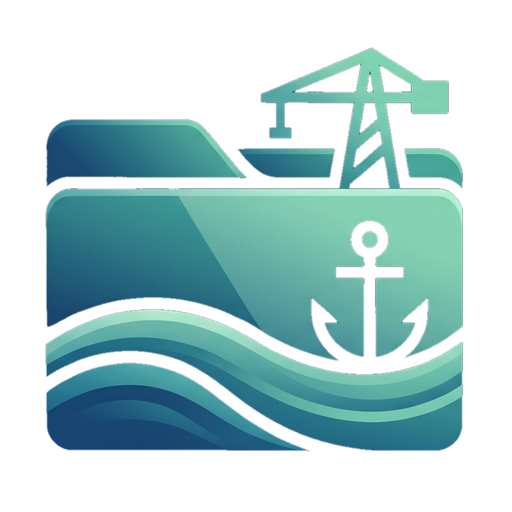
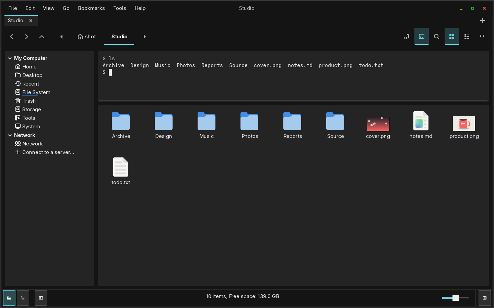
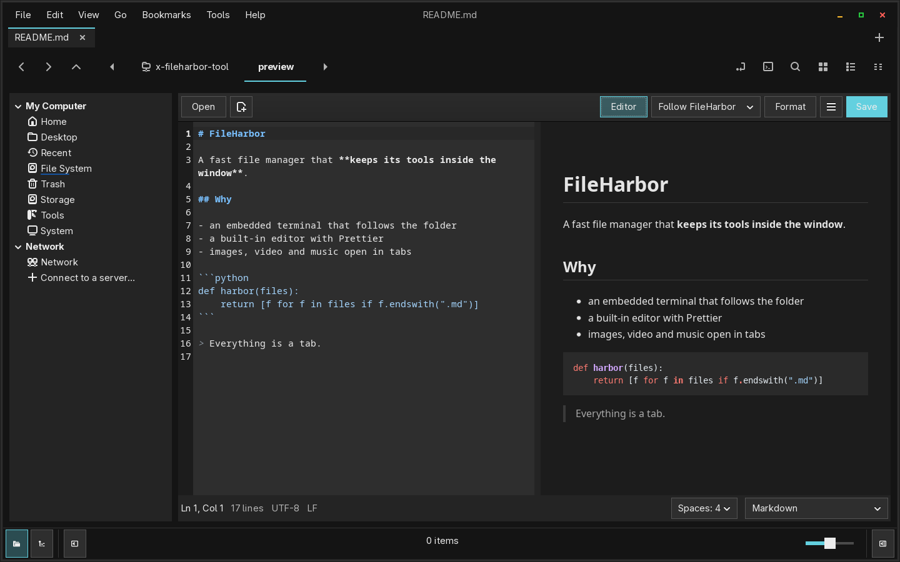
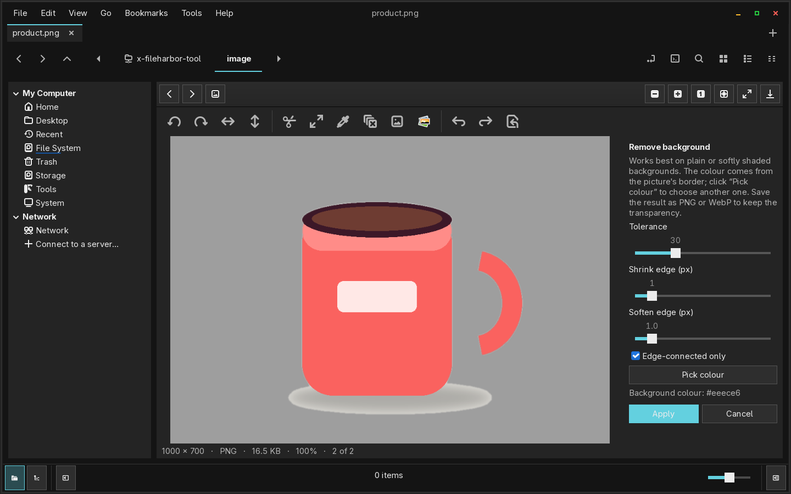
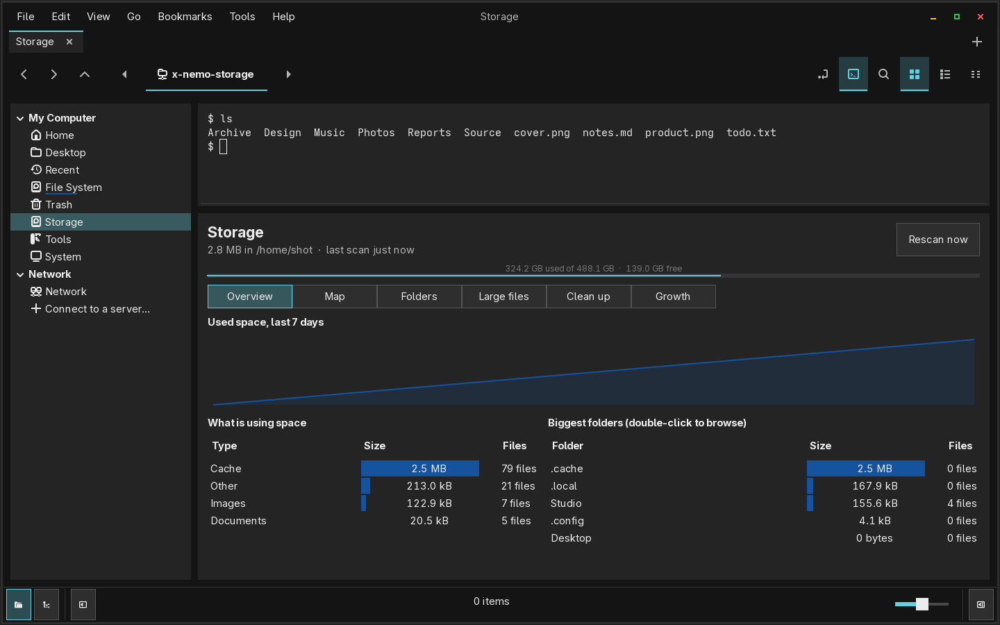

# FileHarbor

FileHarbor is a file manager for Linux, built as a fork of [Nemo](https://github.com/linuxmint/nemo), the
file manager of the Cinnamon desktop. It keeps Nemo's engine, which is fast, mature and full of file
management features, and adds a new look, an embedded terminal, a disk-usage page, remote connections,
built-in tools (text editor, image viewer, media player, developer tools) and an extension system.

- Repository: <https://github.com/asuka-405/FileHarbor>
- Based on: Nemo 6.8.3
- Licence: GPL-2.0-or-later (libraries LGPL-2.0-or-later), as Nemo. See [`COPYING`](COPYING).

## Screenshots

| | |
| --- | --- |
|  |  |
|  |  |

## Credits

FileHarbor exists because of Nemo and the projects before it:

- **Nemo** is developed by the [Linux Mint](https://linuxmint.com) team and its
  [contributors](https://github.com/linuxmint/nemo/graphs/contributors). Almost everything that is not
  listed under "What FileHarbor adds" is their work. Nemo's own README is kept in
  [`docs/upstream/README.md`](docs/upstream/README.md), its history in [`ChangeLog`](ChangeLog) and
  [`NEWS`](NEWS), and its credits in [`AUTHORS`](AUTHORS) and [`THANKS`](THANKS).
- **Nautilus**, the GNOME file manager, which Nemo was forked from, and the **GNOME** and **Cinnamon**
  projects (GTK, GLib, GVfs, cinnamon-desktop, XApp).
- The built-in tools stand on GtkSourceView, WebKitGTK, GStreamer, FFmpeg, VTE, Pillow, Python-Markdown,
  Pygments, PyYAML, LibRaw and Prettier.

FileHarbor is not affiliated with or endorsed by Linux Mint or the Nemo project. Please report problems
in FileHarbor here, not to them.

## What FileHarbor adds on top of Nemo

### Look and layout
- **12 built-in themes**, each with a dark and a light variant. The default, **System**, follows your desktop's
  light or dark setting and default look (COSMIC, GNOME, KDE Plasma, Cinnamon, Hyprland) with a coral accent;
  there are also FileHarbor, Ocean, Forest, Dusk, Sand and Slate, and one per desktop. Themes are small `.ini`
  files; edit everything live in **Edit > Appearance**, which also has the theming guide
  ([`fileharbor/docs/THEMING.md`](fileharbor/docs/THEMING.md)). Set `NEMO_CLASSIC=1` to turn all theming off for one run.
- **Developer mode** (Appearance, `--developer` or `FILEHARBOR_DEV=1`): debug log, GTK inspector, `dev.css` hot
  reload and a developer panel ([`fileharbor/docs/DEVELOPER.md`](fileharbor/docs/DEVELOPER.md)).
- **Menus in the title bar**, coloured window buttons on the right, an always-visible **tab strip**, the
  **breadcrumb bar and terminal at the top** of the file area.
- **Sidebar that fits its content** (140 to 280 px), or a **Miller-column navigator** that shows the
  siblings at every level of the current path (Appearance > Navigator).
- A first-run **walkthrough**, and a preview pane that keeps one on/off setting across folders.

### Embedded terminal
- A VTE terminal panel (F4 or the toolbar button) with search, zoom, links and a themed palette.
- **Linked to the file view in both directions**: `cd` in the shell moves the view, navigating the view
  moves the shell, and over `ssh` the view follows into `sftp://`. Keyboard focus stays in the terminal
  while the shell is driving. Linking can be switched off in Appearance.

### Storage page
- Sidebar > **Storage** (`x-fileharbor-storage:///`). A background service (`fileharbor-storage-daemon`, D-Bus
  `in.archdev.FileHarbor.StorageSense`) indexes your home folder and re-scans when free space changes by 200 MB or
  more. The page shows usage by type, a **treemap**, folders, the largest files, safe-to-clean items and
  what grew recently, with delete, properties and expandable folders.

### Remote connections
- Network > **Connect to a server** builds SFTP, FTP, FTPS, WebDAV, SMB and NFS addresses from plain
  fields and can save them to the sidebar.

### Built-in tools
They open **in tabs of the file manager**, from the sidebar's Tools entry, the Tools menu, or the
right-click menu (which offers only the tools that fit the selection). They are Python/GTK pages that
also run on their own: `fileharbor-tools <tool> [files]`.

| Tool | What it does |
| --- | --- |
| **Text editor** | Syntax highlighting for about 170 languages, search and replace (regular expressions, whole words), go to line, toggle comment, indentation detection, minimap, zoom, whitespace display, encodings and line endings, recovery copies of unsaved work, 19 colour themes, and **Prettier** formatting (button, Ctrl+Shift+I, optional format on save; it uses the project's own Prettier config). |
| **Markdown and MDX** | Live preview next to the text with a button that collapses the editor. MDX components render as labelled boxes with their Markdown inside, callouts get a coloured edge, imports/exports collapse, `{expressions}` show as chips, front matter renders as a table, code blocks are coloured. |
| **Images** | Viewer and editor (rotate, crop, resize, adjust, background removal for plain backgrounds) for common formats and camera RAW, plus batch resize and convert with presets. |
| **Media player** | Music and video in one player. Trim, convert, extract audio, make a GIF. |
| **Developer tools** | JSON, YAML, Base64, URL and HTML encoding, hashes, UUID/ULID, passwords, timestamps, number bases, colours, regex tester, JWT, diff, cron and text utilities. |

Double-clicking Markdown opens the preview, and text, code, pictures, video and music open in their tool
tab. Each of these can be turned off in Appearance; scripts you can run, web pages and launchers keep
their normal action.

### Extensions
A folder with an `extension.json` can add context-menu actions, sidebar entries, custom pages (a script
that prints JSON), Tools-menu entries and themes. Turn them on and off in **Tools > Extensions**. See
[`fileharbor/docs/EXTENSIONS.md`](fileharbor/docs/EXTENSIONS.md) and the bundled
[`fileharbor/extensions/system-glance`](fileharbor/extensions/system-glance). Extensions run with your
permissions: only install ones you trust.

## Install

FileHarbor installs the `fileharbor` binary (with `nemo` and `nemo-desktop` links so old scripts, nemo actions
and extensions keep working) and keeps Nemo's library and data file names, so it **replaces** the `nemo` package
rather than installing beside it. Its settings are separate from Nemo's: they live under
`in.archdev.FileHarbor.*` (gsettings) and `~/.config/fileharbor`, and the first run copies an existing Nemo
configuration across.

### Arch Linux (AUR)

    yay -S fileharbor          # or any AUR helper

Until the package is published, build it from this repository:

    git clone https://github.com/asuka-405/FileHarbor.git
    cd FileHarbor/packaging/aur
    makepkg -si

### Flatpak

A manifest is in [`packaging/flatpak`](packaging/flatpak). It has **not been built or tested yet**, and
a sandbox limits the embedded terminal and device access, see [`packaging/README.md`](packaging/README.md).

    flatpak-builder --user --install --force-clean build-flatpak packaging/flatpak/in.archdev.FileHarbor.yml
    flatpak run in.archdev.FileHarbor

### Releases

Source tarballs, the Arch package and a Flatpak bundle are attached to the [releases](https://github.com/asuka-405/FileHarbor/releases). Production releases (`vX.Y.Z`) are built and published to the AUR automatically, see [`packaging/README.md`](packaging/README.md).

### One-time setup

`fileharbor-setup` (from a checkout: `scripts/setup.sh`) walks through the settings (theme, roundness,
spaciousness, browsing, built-in tools), the Storage Sense service and the desktop integration, then applies
them. Details in [`fileharbor/docs/SETUP.md`](fileharbor/docs/SETUP.md).

    fileharbor-setup                   # for your account
    sudo fileharbor-setup --system     # defaults for every account
    fileharbor-setup --yes --storage always --theme ocean
    fileharbor-setup --undo

## Build from source

### Dependencies

Nemo's usual build dependencies, plus the ones FileHarbor adds. On Arch:

    sudo pacman -S --needed base-devel meson gobject-introspection \
        gtk3 glib2 json-glib cinnamon-desktop xapp libexif exempi libxmlb dconf gvfs \
        gst-plugins-base gst-plugins-good vte3 python python-cairo python-gobject \
        python-pillow python-markdown python-pygments python-yaml gtksourceview4 webkit2gtk-4.1 ffmpeg \
        prettier libraw gst-libav catdoc

`prettier` (format code in the editor), `libraw` (camera RAW), `gst-libav` (more formats) and `catdoc`
(search in old Word files) are optional: FileHarbor runs without them and just turns that feature off. The
AUR package, the Flatpak and the Debian packaging install them by default.

On Debian or Ubuntu the package names differ (`libvte-2.91-dev`, `libjson-glib-dev`, `libcinnamon-desktop-dev`,
`libxapp-dev`, `python3-dev`, `gir1.2-gtksource-4`, `gir1.2-webkit2-4.1`, `python3-pil`, `python3-markdown`,
`python3-pygments`, `python3-yaml`, `ffmpeg`, and for the optional features `node-prettier`, `libraw-bin`,
`gstreamer1.0-libav`, `catdoc`); `packaging/debian` is Nemo's inherited packaging and is not
maintained for FileHarbor.

### Build, run, test

    git clone https://github.com/asuka-405/FileHarbor.git
    cd FileHarbor
    scripts/build.sh                # configure on first run, compile, install into ./install
    scripts/run.sh                  # isolated session: own D-Bus, your system file manager untouched
    scripts/run.sh --live           # your real session and settings; quits a running Nemo first
    scripts/test.sh                 # tests for the tools' logic

`scripts/install-launcher.sh` registers the checkout with your desktop (FileHarbor name and icon in the menu and dock, and the folder-opening role; add `--default` to make it the default file manager, `--remove` to undo).

Without the scripts: `meson setup build --prefix=$PWD/install --libdir=lib -Dtracker=false`, then
`ninja -C build install` and `glib-compile-schemas install/share/glib-2.0/schemas`. For a system install
use `--prefix=/usr`.

## Repository layout

The tree is Nemo's. FileHarbor's non-C parts live in their own folders, fork-only C files sit next to
Nemo's with their own names, and changes inside Nemo's files are small hooks marked with a `FileHarbor`
comment, so comparing with a new Nemo release stays manageable.

    fileharbor/
      tools/            built-in tools: Python/GTK pages (fhtools/), `fileharbor-tools`, tests/
      extensions/       bundled sample extension (system-glance)
      storage-sense/    indexing service (D-Bus: in.archdev.FileHarbor.StorageSense)
      docs/             THEMING.md, DEVELOPER.md, SETUP.md, EXTENSIONS.md
    scripts/            build.sh, run.sh, test.sh, release.sh
    packaging/          aur/, flatpak/, debian/ (inherited)
    docs/upstream/      Nemo's own README
    src/                Nemo, plus: nemo-storage-view, nemo-theme-manager, nemo-appearance-window,
                        nemo-tab-strip, nemo-column-nav, nemo-terminal-panel, nemo-remote-connections,
                        nemo-tool-view, nemo-ext-page-view, nemo-extensions-window,
                        fileharbor-python, fileharbor-tools-menu
    libnemo-private/    Nemo, plus: fileharbor-extensions (discovery, tool catalogue, file kinds)
    gresources/         Nemo UI files, plus fileharbor-base.css (theme template)
    data/themes/        built-in themes (.ini)
    data/shell-integration/   shell hooks for the terminal (bash, zsh, ssh)

## Releasing

See [`packaging/README.md`](packaging/README.md#releases). In short: update `VERSION` and
[`CHANGELOG.md`](CHANGELOG.md), commit, run `scripts/release.sh --tag`, push the tag.

## Keeping up with Nemo

This repository does not carry Nemo's history. To take a new Nemo release, check out the new and the
old upstream tags side by side and compare them (`git diff --no-index`); the `FileHarbor` marker
comments show where this fork touches Nemo's files.

## Contributing

Bug reports and pull requests are welcome at <https://github.com/asuka-405/FileHarbor>. Run
`scripts/test.sh` before sending changes.
